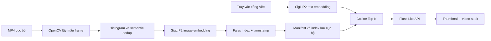

# Rewind Lite

**Định vị keyframe trong video bằng truy vấn tiếng Việt.** Đây là bản Lite phục vụ tiểu luận chuyên ngành Artificial Intelligence. Đầu vào là MP4 cục bộ và một câu mô tả; đầu ra là các ảnh keyframe có `video_id`, `frame_id`, timestamp, rank và điểm cosine. Chọn kết quả trên giao diện sẽ tua video tới timestamp đó. Hệ thống trả **điểm thời gian**, không dự đoán ranh giới đoạn `[start, end]` của full Temporal Sentence Grounding.

## Trạng thái và đóng góp

Đường Lite T03–T08 đã có CLI, index lưu/nạp, API và giao diện. T05 có **2 video được phép dùng ở các split `dev`/`test`, 14 nhãn draft và 0 truy vấn tiếng Việt đã được xác minh**. Vì vậy T06 chưa có số đo accuracy hợp lệ; không được dùng kết quả smoke hoặc nhãn legacy để kết luận chất lượng retrieval. [Trạng thái từng task](docs/task-status.md), [giao thức chấm T02](docs/rewind-lite-task-02-protocol.md), [dữ liệu T05](docs/rewind-lite-task-05-dataset.md), [benchmark T06](docs/rewind-lite-task-06-benchmark.md).

SigLIP/SigLIP2, PyTorch, OpenCV và Faiss là thành phần pretrained/thư viện bên ngoài. Rewind Lite tái sử dụng ingestion, encoder và index từ Rewind gốc; phần triển khai của Lite gồm đường single-encoder có manifest và cache, hợp đồng tìm kiếm, validator nhãn, benchmark E1/E2/E3 có gate dữ liệu, API và UI. Các module Agent, VQA, OCR/ASR, image search và temporal search của Rewind gốc vẫn nằm trong repository nhưng không thuộc đường Lite.

## Kiến trúc Lite



CLI và UI mặc định dùng **một** encoder `google/siglip2-base-patch16-256` tại revision `6328738b83b563ff8396fdb87f8ce130a7b60d74`. Ảnh được lấy mẫu mỗi 1 giây (CLI mặc định tối đa 64 frame), lọc trùng histogram ngưỡng 0.985 rồi semantic dedup ngưỡng 0.97. Text tiếng Việt được đưa nguyên văn vào processor với `padding=max_length`, `max_length=64`, `truncation=True`. Vector được chuẩn hóa L2; điểm dense là cosine. Với chỉ mục nhỏ, retriever dùng tìm kiếm exact; cấu hình Faiss HNSW được lưu trong manifest. [Chi tiết T03](docs/rewind-lite-task-03-environment.md), [hợp đồng core T04](docs/rewind-lite-task-04-core.md).

## Cài đặt trên Windows PowerShell

Cần Windows, Python **3.11** cho môi trường GPU đã kiểm thử, `uv`, GPU NVIDIA và driver tương thích CUDA 12.1. Môi trường CPU có thể chạy test và CLI với `--device cpu`, nhưng không chứng minh hiệu năng GPU. `requirements-gpu.txt` pin các gói model chính; các phụ thuộc còn lại dùng ngưỡng tối thiểu trong `requirements.txt`. Phiên bản thực của từng lần index được lưu ở `manifest.json`.

```powershell
cd <thu-muc-rewind-lite>
$env:UV_CACHE_DIR = "$PWD\artifacts\uv-cache"
uv python install 3.11.15 --install-dir "$PWD\artifacts\python"
uv venv --python "$PWD\artifacts\python\cpython-3.11.15-windows-x86_64-none\python.exe" .venv
uv pip install --python .venv\Scripts\python.exe -r requirements-gpu.txt
uv pip check --python .venv\Scripts\python.exe
.venv\Scripts\python.exe -c "import torch; print(torch.__version__, torch.cuda.is_available()); print(torch.cuda.get_device_name(0) if torch.cuda.is_available() else 'CPU')"
.venv\Scripts\python.exe -m pytest -o addopts='' -q
```

Nếu đã có Python 3.11, có thể tạo `.venv` từ interpreter đó và giữ nguyên lệnh `uv pip install`. Lần đầu cần tải model; đặt `HF_HOME` để chọn cache hoặc để mặc định trong `artifacts/hf-cache/`. `AIC_HF_HOME` chỉ được dùng khi `HF_HOME` chưa đặt. Không thêm cache/model/video vào Git. Sau khi cài, ghi lại toàn bộ package của máy vào artifact cục bộ:

```powershell
uv pip freeze --python .venv\Scripts\python.exe > artifacts\dependency-freeze.txt
```

Môi trường kiểm thử hiện có: Python 3.11.15, PyTorch 2.5.1+cu121, Transformers 4.57.3, NumPy 1.26.4, Faiss CPU 1.15.1, OpenCV headless 4.11.0.86, Flask 3.1.3; GPU NVIDIA GeForce RTX 3060 Laptop GPU. Đây là **log môi trường**, không phải yêu cầu phần cứng tối thiểu cho mọi người dùng. [Thiết lập và phép thử CUDA T03](docs/rewind-lite-task-03-environment.md).

## Index và tìm kiếm bằng CLI

Đặt video MP4 của bạn ở đường dẫn cục bộ; ví dụ `video-test.mp4` là video được chủ repository cấp quyền, **không** nằm trong Git. Lần đầu lệnh tạo index, các lần sau dùng lại nếu checksum video, model và sampling khớp. Đổi cấu hình thì thêm `--rebuild`.

```powershell
.venv\Scripts\python.exe -m scripts.lite_search video-test.mp4 "người đang đi bộ" --index-dir artifacts\indexes\video-test --every 1 --max-frames 64 --top-k 5 --device cuda
.venv\Scripts\python.exe -m scripts.lite_search video-test.mp4 "xe trên đường" --index-dir artifacts\indexes\video-test --every 1 --max-frames 64 --top-k 5 --device cuda
```

Thay `--device cuda` bằng `--device cpu` khi không có CUDA. `manifest.json` và `last-run.json` nằm trong thư mục index, cùng version, checksum, thời gian và kết quả. Index dùng pickle cục bộ: chỉ nạp artifact do chính bạn tạo từ nguồn tin cậy.

## Web demo và API

```powershell
.venv\Scripts\python.exe -m ui.lite_app
```

Mở `http://127.0.0.1:5000/`. Sidebar cho phép tải MP4 lên hoặc chọn video đã có trong `data/videos/`. Sau khi index xong, nhập truy vấn tiếng Việt, xem tối đa 5 thumbnail và chọn kết quả để tua video. Index mặc định lưu ở `artifacts/indexes/`. Server chỉ lắng nghe `127.0.0.1`; tiến độ và cache model nằm trong một process. [Hợp đồng HTTP và lỗi T07](docs/rewind-lite-task-07-api.md), [kiểm tra UI T08](docs/rewind-lite-task-08-ui.md).

## Dữ liệu và đánh giá

`data/annotations/manifest.json` ghi nguồn, quyền dùng, checksum, metadata và split. `data/annotations/labels.json` hiện có 14 nhãn **draft** chờ review độc lập; không hàng nào được tính là verified. Hai file `evaluation/labels*.json` là dữ liệu Rewind cũ chưa kiểm tra với video nguồn nên **không** thuộc tập đánh giá Lite. Video, index, contact sheet, benchmark JSON tạo ra ở máy của người chạy và bị Git ignore.

```powershell
.venv\Scripts\python.exe -m evaluation.dataset --manifest data\annotations\manifest.json --labels data\annotations\labels.json --root . --every 1
.venv\Scripts\python.exe -m evaluation.lite_benchmark --check
.venv\Scripts\python.exe -m evaluation.lite_benchmark --manifest data\annotations\manifest.json --labels data\annotations\labels.json --root . --output artifacts\benchmarks\t06.json --device cuda --every 1 --top-k 5
```

Validator có thể báo metadata hợp lệ trong khi bộ dữ liệu chưa đủ. `--check` và benchmark trả `DATA_BLOCKED` (exit 3) cho đến khi có ít nhất 50 truy vấn tiếng Việt verified, video `dev` và `test` độc lập. Khi gate mở, report JSON có config, per-query predictions, coverage, Hit@1/5, Recall@5, MRR, timing, VRAM và so sánh E1/E2/E3; report Markdown nằm cạnh JSON. [Quy trình gán nhãn T05](docs/rewind-lite-task-05-dataset.md), [thiết kế benchmark T06](docs/rewind-lite-task-06-benchmark.md). Artifact dự kiến: `artifacts/benchmarks/t06.json` và `artifacts/benchmarks/t06.md`; **chưa có report đo hợp lệ để liên kết/publish**.

| Chỉ số / bằng chứng | Kết quả thực hiện có | Ý nghĩa |
|---|---:|---|
| Video được xác nhận quyền dùng | 2 (`dev` và `test`) | Hai cảnh khác nhau, mỗi split một clip ngắn |
| Truy vấn tiếng Việt draft / verified | 14 / 0 | Chưa có mẫu đã review để chấm accuracy |
| Hit@1, Hit@5, Recall@5, MRR E1/E2/E3 | Chưa đo | T05/T06 `DATA_BLOCKED` |
| Smoke CLI SigLIP2 trên video 23.86 giây | 2 keyframe, timestamp 0.0 và 5.0 giây | Chỉ xác nhận đường index/search hoạt động |
| Thời gian build index đầu tiên | 9.332 giây | Một lần chạy T03, 2 frame, GPU nêu trên; không là benchmark throughput |

Các điểm lỗi cần phân tích khi có nhãn verified: query bị sai ngôn ngữ/ngữ nghĩa, nhầm thuộc tính hoặc hành động, sự kiện bị bỏ qua do sampling, ảnh mơ hồ, hoặc nhãn/window chưa chính xác. Phải xem video và predictions từng query trước khi gán nguyên nhân. Hiện chưa có 5–10 ca lỗi được xác minh. Không kết luận mô hình nào tốt hơn từ video demo này.

## Giới hạn và xử lý lỗi thường gặp

- **`DATA_BLOCKED`:** bổ sung video được phép dùng, nhãn tiếng Việt có reviewer và split độc lập theo hướng dẫn T05; không sửa nhãn theo kết quả tìm kiếm.
- **`torch.cuda.is_available() == False`:** kiểm tra đúng `.venv`, PyTorch CUDA và driver; có thể chạy `--device cpu` nhưng ghi rõ đó là CPU.
- **Model chưa có trong cache:** lần đầu cho phép tải; nếu chạy offline, chuẩn bị snapshot trước rồi mới đặt `HF_HUB_OFFLINE=1`.
- **Index hết hạn/không tương thích:** kiểm tra checksum, model revision và `--every`/`--max-frames`; dùng `--rebuild` để tạo lại từ MP4 tin cậy.
- **Chỉ trả ít kết quả:** dedup có thể giữ ít hơn Top-5; video mẫu hiện chỉ giữ 2 keyframe.
- **Upload lỗi:** dùng MP4 đọc được bằng OpenCV và nhỏ hơn giới hạn 512 MiB mặc định của UI.

[Kịch bản demo, dàn ý báo cáo và checklist phát hành](docs/rewind-lite-task-09-release.md).
